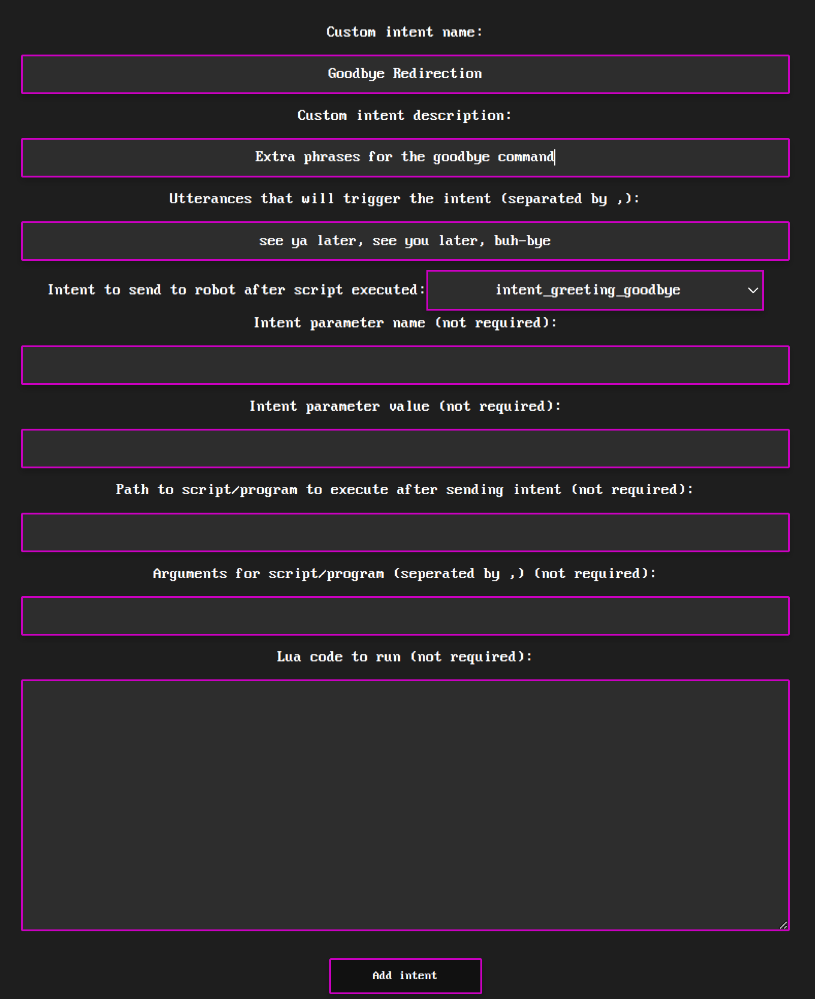
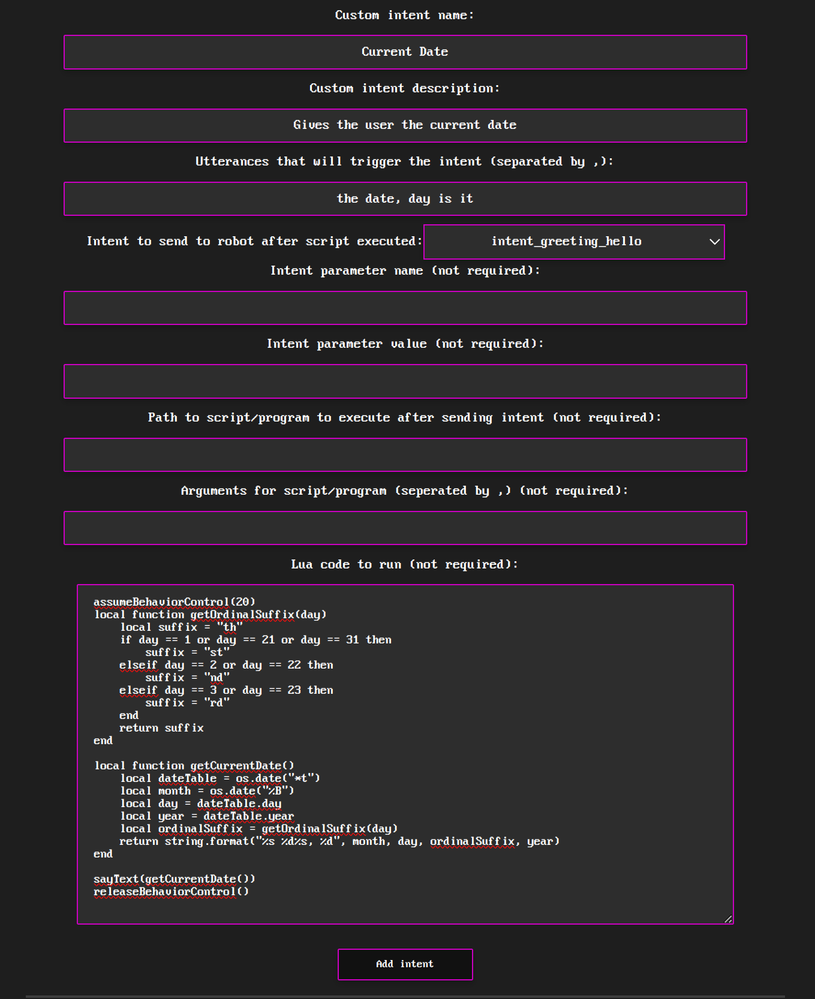

# my-vector

my-vector gives the Anki (now Digital Dream Labs) [Vector](https://web.archive.org/web/20190417120536if_/https://www.anki.com/en-us/vector) robot a large-language-model brain, PC-generated voices, Estonian speech recognition and a long-term memory. It is built on top of [wire-pod](https://github.com/kercre123/wire-pod), the open-source Vector server.

## Demo

The two screenshots below are from upstream wire-pod: its custom-intent editor, which my-vector keeps unchanged. They show the web UI my-vector builds on, not a my-vector feature; my-vector's own additions are listed in [What my-vector adds](#what-my-vector-adds).





<!-- robot-video -->

## What my-vector adds

- **LLM answers** — each language picks its own brain, a local Ollama model or Claude, configured from the web UI (`chipper/pkg/myvector/llm`, trial notes in [docs/llm-trials.md](docs/llm-trials.md)). Estonian answers come from TartuNLP's Estonian LLMs on Ollama — see [Estonian models](#estonian-models).
- **PC voices** — Vector speaks LLM answers and its built-in lines through a local TTS service (Kokoro and Piper voices, Estonian Piper voices included — see [Estonian models](#estonian-models)), falling back to the robot's own voice when the service is down (`tts/`, `chipper/pkg/myvector/voice`).
- **Estonian speech recognition** — a faster-whisper STT service runs TalTech's Estonian Whisper model on the GPU ([Estonian models](#estonian-models)), with an English model for English; the language is switched from the web UI (`et-stt/`, `chipper/pkg/myvector/lang`).
- **Live answers** — weather, news and other current questions are routed to web search (Tavily, or a local SearXNG) and a weather forecast before the LLM answers (`chipper/pkg/myvector/search`).
- **Picture questions** — ask "what is in this picture?" and Vector describes what its camera sees; follow-up questions reuse the last photo (`chipper/pkg/myvector/photo`).
- **Long-term memory** — conversations are captured per robot; a nightly pass pulls facts out of finished sessions, merges them with the ones already held, rebuilds a short profile and keeps a diary. A guard asks fixed questions before and after each merge and reverts the pass if an answer is lost. Facts can be reviewed and removed from the web UI; the memory model is local Ollama or Claude, picked separately (`chipper/pkg/myvector/memory`).
- **Follow-up listening** — after each answer a quick yes/no call decides whether Vector should listen again, so a conversation can go on without repeating the wake word, up to a capped chain (`chipper/pkg/myvector/followup`).
- **Prompt templates** — the system prompt is an editable template per brain (Ollama, Claude) with blocks such as `{facts}`, `{diary}`, `{search}` and `{lang}`, a preview, and the last few saves kept for restore, on the `/myvector/prompt` page (`chipper/pkg/myvector/prompt`).
- **Sound lock** — saying "shut up", or running `make quiet`, locks every robot sound path for a while: robot sound scripts are blocked, Vector naps and the volume drops (`chipper/pkg/myvector/quiet`, `robot/quiet/`).
- **WireOS unlock and Tailscale** — the robot is unlocked and runs WireOS with a patch series that lets it live on the charger and still answer "Hey Vector" (`robot/unlock/`, [`robot/firmware/`](robot/firmware)); a Tailscale tunnel on the robot itself carries its traffic to the server, so it also works on WiFi networks I do not control (`robot/tailscale/`).
- **WiFi hardening** — the robot's public root SSH key is replaced by a new one, each robot gets its own sshd host keys, and the server's TLS certificate comes from its own CA instead of the public escapepod one, and a firewall on the robot limits who can reach it (`robot/netguard/`); a WiFi page tests, switches and roams between the robot's saved networks (`robot/sshkey/`, `robot/hostkey/`, `chipper/pkg/myvector/wifi`).

## Quickstart

The PC side runs from the [Makefile](Makefile); `make help` lists every target. In short: set up and enable the TTS and STT services (`make tts-setup`, `make tts-enable`, `make stt-setup`, `make stt-enable`), then install wire-pod as a service with `make daemon-enable` and start it with `make start`. The robot still needs wire-pod's own setup first — see [Base: wire-pod](#base-wire-pod).

## Architecture

```text
 Vector robot (WireOS)                      PC: chipper (wire-pod server, Go)
 robot/firmware patches   <-- voice -->     upstream wire-pod + chipper/pkg/myvector
 robot/quiet, wifi, tailscale                          |
              +--------------+-------------------------+----------------+
              |              |                         |                |
        STT: et-stt/    TTS: tts/                 LLM: Ollama      search: Tavily or
        faster-whisper  Kokoro + Piper            or Claude        SearXNG, + weather
```

## Estonian models

In Estonian mode Vector hears, thinks and speaks with local Estonian models, each picked on the **Language, brain & voice** page (`/myvector/voice`); English keeps its own. Setup steps and scores: [docs/estonian-models.md](docs/estonian-models.md).

| step | model | name in my-vector | get it |
|---|---|---|---|
| hear (STT) | [TalTechNLP/whisper-large-v3-turbo-et-verbatim](https://huggingface.co/TalTechNLP/whisper-large-v3-turbo-et-verbatim) | `et-stt/` service | `make stt-setup && make stt-enable` |
| think (LLM, in use) | [tartuNLP/Apertus-EstLLM-8B-Instruct-0326](https://huggingface.co/tartuNLP/Apertus-EstLLM-8B-Instruct-0326), [GGUF](https://huggingface.co/mradermacher/Apertus-EstLLM-8B-Instruct-0326-i1-GGUF) `i1-Q4_K_M` | Ollama `apertus-estllm:8b` | download, swap in a fixed chat template, `ollama create` ([steps](docs/estonian-models.md#apertus-estllm--download-swap-the-chat-template-create)) |
| think (LLM, alternative) | [tartuNLP/Llama-3.1-EstLLM-8B-Instruct-1125](https://huggingface.co/tartuNLP/Llama-3.1-EstLLM-8B-Instruct-1125), [GGUF](https://huggingface.co/mradermacher/Llama-3.1-EstLLM-8B-Instruct-1125-i1-GGUF) `i1-Q4_K_M` | Ollama `hf.co/mradermacher/Llama-3.1-EstLLM-8B-Instruct-1125-i1-GGUF:i1-Q4_K_M` | `ollama pull` that name |
| speak (TTS) | Piper [`et_EE-news-medium`](https://huggingface.co/rhasspy/piper-voices/tree/main/et/et_EE/news/medium) | voices `mari`, `albert`, `kalev` | download the voice ([steps](docs/estonian-models.md#estonian-voices-tts)), then `make tts-setup && make tts-enable` |

## How it was built

I built my-vector with coding agents. Every change starts as a written plan with my rulings in it, is built in small committed stages with tests, and is checked by a separate reviewer agent before the plan is archived. What went well: the plans made long work resumable from one session to the next, and the reviewer, reading a whole stage range cold, caught what green stage tests could not — a memory fact I had removed on the settings page could still reach the model during the nightly pass. What the agents got wrong was mostly settling too early. One blamed an animation crash on memory corruption and archived the hunt as "no repro"; when the crash came back, a re-read of the call site found a soft-float library calling a hard-float libc function with no bridge. Another picked a news-answer opener because it won the replay, accepting that it credited items to the wrong outlet; I rejected it and asked for new arms. And a one-language helper for the camera model would have stayed beside the general setting if I had not ruled it deleted.

- [Hard debugging: the crash the agent blamed on memory corruption](docs/how-it-was-built.md#hard-debugging-the-crash-the-agent-blamed-on-memory-corruption)
- [Design rejected: the agent's winning opener credited the wrong source](docs/how-it-was-built.md#design-rejected-the-agents-winning-opener-credited-the-wrong-source)
- [Agent bug caught: a removed memory fact could still reach the model](docs/how-it-was-built.md#agent-bug-caught-a-removed-memory-fact-could-still-reach-the-model)
- [Agent debt deleted: the one-off vision helper the setting replaced](docs/how-it-was-built.md#agent-debt-deleted-the-one-off-vision-helper-the-setting-replaced)

Map of the docs, plans and archived plans: [docs/README.md](docs/README.md). Method and agent configuration: [claudeconf](https://github.com/KristjanHS/claudeconf).

<!-- agentic-stats:start -->
| Metric | Value | Definition |
|---|---|---|
| Tests | +609 over wire-pod | static count: lines matching `^func Test\w*\(` in `*_test.go`; `^\s*(async\s+)?def test_` in `test_*.py`, `*/test_*.py`, `*_test.py` at HEAD, excl. `.claude`; `.each`/parametrized cases count once (delta vs wire-pod) |
| CI gates | 1 | workflows triggered on push / pull_request / merge_group; schedule- or dispatch-only ops jobs excluded |
| Releases | — | not tracked |
| ADRs | — | not tracked |
| Lines | +59125 over wire-pod | scc code lines (no blanks/comments) at HEAD, excl. docs/data formats, `.claude` (delta vs wire-pod) |
| In prod since | — | first production deploy (manual) |
<!-- agentic-stats:end -->

## Base: wire-pod

my-vector is a fork of `wire-pod`, fully-featured server software for Vector created thanks to Digital Dream Labs' [open-sourced code](https://github.com/digital-dream-labs/chipper). wire-pod lets voice commands work with any Vector 1.0 or 2.0 for no fee, including regular production robots.

- Installation: wire-pod's [installation guide](https://github.com/kercre123/wire-pod/wiki/Installation)
- Wiki: the [wire-pod wiki](https://github.com/kercre123/wire-pod/wiki) covers what wire-pod is, installing it, troubleshooting, developing for it, and general tips

## Credits

- [wire-pod](https://github.com/kercre123/wire-pod) by [Kerigan Creighton (kercre123)](https://github.com/kercre123) — the server my-vector is built on
- [Digital Dream Labs](https://github.com/digital-dream-labs) for open sourcing chipper and creating escape pod (which made wire-pod possible)
- [bliteknight](https://github.com/bliteknight) for making wire-pod more accessible with his easy-to-use pre-setup Linux boxes
- [dietb](https://github.com/dietb) for rewriting chipper and giving tips
- [fforchino](https://github.com/fforchino) for adding many features such as localization and multilanguage, and for helping out
- [xanathon](https://github.com/xanathon) for the publicity and web interface help
- Anyone who has opened an issue and/or created a pull request for wire-pod

## License

MIT, under three upstream notices that are kept as they are: [LICENSE](LICENSE) (Copyright (c) 2022 Kerigan Creighton, wire-pod), [chipper/LICENSE](chipper/LICENSE) and [vector-cloud/LICENSE](vector-cloud/LICENSE) (both Copyright (c) 2021 Digital Dream Labs).
