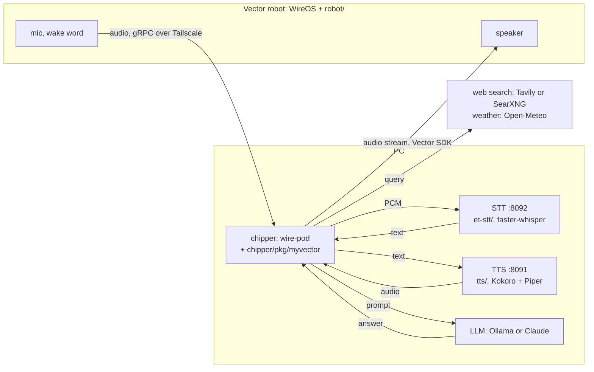

# Architecture

One Vector robot talks to one PC. The robot runs WireOS with the patches in `robot/firmware/`. The PC runs chipper, wire-pod's Go server with the fork's code in `chipper/pkg/myvector`, next to a local STT and a local TTS service.

## One spoken ask

1. "Hey Vector" wakes the robot, and it streams the mic audio to chipper over gRPC. The robot reaches the PC through its Tailscale tunnel.
2. chipper collects the audio and posts it to the STT service at `/stt?lang=<current language>`. If STT fails, the ask fails. wire-pod's Vosk is not used as a fallback.
3. wire-pod's intent matcher gets the text first. Text that matches no intent goes to upstream's LLM path in `chipper/pkg/wirepod/ttr/kgsim.go`, which calls into the fork through hooks in the `fork_*.go` files beside it.
4. When the question needs current facts, chipper first adds web search results or a weather forecast to the prompt (`chipper/pkg/myvector/search`). The LLM picked for the current language then writes the answer.
5. chipper posts the answer to the TTS service at `/tts` and streams the audio to the robot through the SDK's external audio stream, paced to real time. If TTS fails before any audio has played, the robot says the answer with its built-in text-to-speech (`chipper/pkg/myvector/voice`).

## Decisions

### Fork code beside upstream, not in it

New code goes in `chipper/pkg/myvector`. Where it has to hook into an upstream package, a `fork_*.go` file is added to that package. Any other edit to an upstream file has to be listed in `scripts/upstream-drift.sh`, and `make check` fails on an edit that isn't on the list.

The alternative was editing wire-pod's files in place. Updates come in with `git merge upstream/main`, and every in-place edit is a line that can conflict with upstream's next change to it. The boundary costs some indirection, since a reader has to follow the hook in `fork_*.go` to find the code it runs.

### Tailscale on the robot

The robot has to stay safe on public WiFi, and keep working away from home while the PC stays there. [The WiFi security plan](plans/2026-11-07-public-wifi-security.md) compared four options. The chosen one runs `tailscaled` on the robot itself ([shipped plan](plans/archive/2026-11-10-robot-tailscale.md)). The robot then talks only to the PC's tailnet address, and its firewall drops everything on `wlan0` except established traffic, DHCP and Tailscale's UDP.

Hardening in place on the shared WiFi (own CA, pinned hosts, API auth) was rejected because it needs the most firmware patching and still fails behind a captive portal or with client isolation. A phone or laptop hotspot is free, but it does nothing when the PC stays at home. A travel router (about €40–120) handles captive portals with no firmware work. It is one more device to carry, though, and like the hotspot it leaves the home network unprotected.

The tunnel has its own costs. Behind a captive portal the robot still needs a hotspot or router to get online. And `tailscaled` has to fit a memory budget of about 40 MB on a robot with about 220 MB free (census in the WiFi plan).

### Web search: Tavily, then SearXNG

Search providers sit behind one Go interface, and each has a monthly call cap. The default order is Tavily, then a self-hosted SearXNG (`scripts/searxng.sh`). On the bench of 10 Estonian queries the two scored about the same on relevance (2.20 and 2.30 out of 3), and Tavily answered about 4 times faster.

Brave was never added because it has no free tier. Ollama's web search was the third provider until [23a7fcd](https://github.com/KristjanHS/my-vector/commit/23a7fcd) removed it. It is paid only (HTTP 402) and never made the default order. Ollama itself is still the local LLM backend.
